# UHF RFID Tool Inventory System - "Emma's RFID Thing"

### A low-cost, UHF RFID system that automatically checks whether your tools are accounted for.

https://github.com/user-attachments/assets/c475d00b-563d-4544-90bf-386b262ad7c9

_"RFID Goofin'" with the range turned down for a demo_

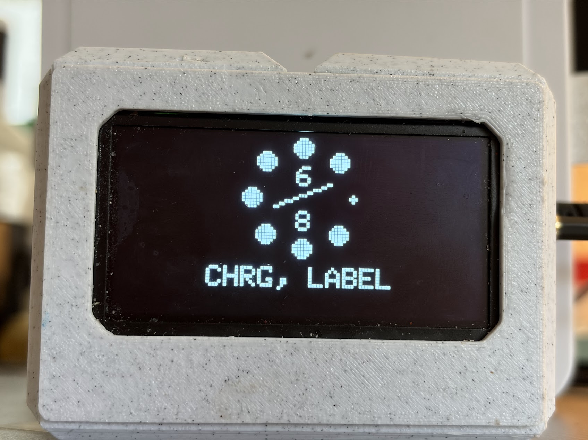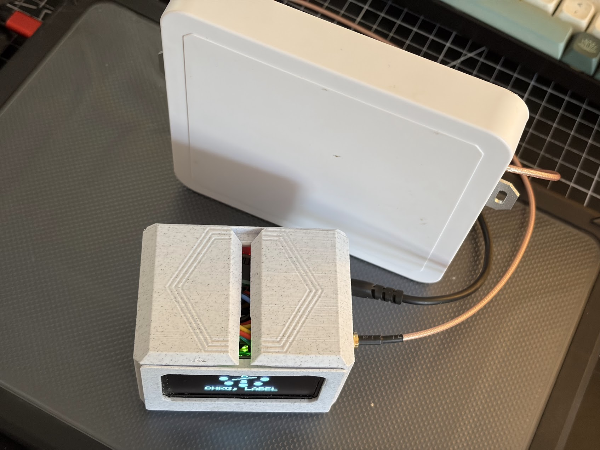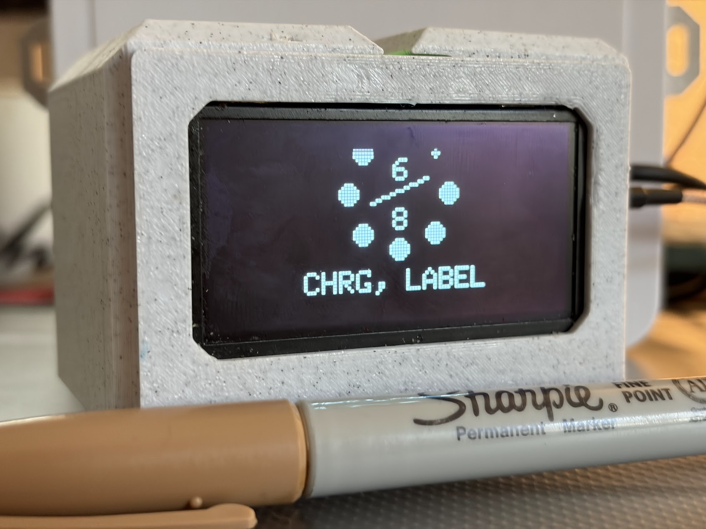

_The display shows 6 of 8 expected items detected. The missing items are identified as my MacBook charger (CHRG) and label maker (LABEL)._

---

## Abstract

I built a low-cost UHF RFID inventory system to keep track of my work tools. The USB-powered device sits in my car and checks whether I've left anything behind at a job site.

Costing approximately $120 in materials, this self-contained device combines an ESP32, a UHF RFID reader, a circularly polarized antenna, and an OLED display. It can detect passive UHF RFID tags from 10–20 feet away with only a slight reduction in range for some obstructed configurations.

The concept is simple: I attach RFID stickers to the tools I care about, and the device checks for their presence automatically. If every expected tag is detected, a check mark appears on the screen, indicating I am ready to leave. The names of any missing items are displayed on the screen during scanning.

This makes it easy to check whether my tools are accounted for before leaving a job site, and the system has already helped me avoid several expensive mistakes.

## Key Features

- Nearly instant detection of multiple tags.

- Matches detected EPC identifiers against a predefined list of saved tools.

- OLED display shows scan progress and identifies outstanding items.

- Provides a clear visual indication when all expected tags have been found.

- Uses a low cost microcontroller and off the shelf RFID hardware.

- Includes documentation of firmware, hardware, and 3D-printable enclosure files for reproducibility.

## Motivation

I was recently at Topgolf, which uses RFID alongside other technologies to track golf balls across its driving ranges. I found it fascinating that RFID could help identify objects among many others in a large area, without requiring each object to carry its own battery-powered electronics.

That got me thinking about the practical limits of RFID technology and what I could build with it. I'd just lost an expensive work tool and was pretty bummed out about it, so an automated inventory system sounded like a great idea.

**Here's the concept: I put RFID stickers on the stuff I care about, and a reader in my car tells me if any items are missing.**

## Background

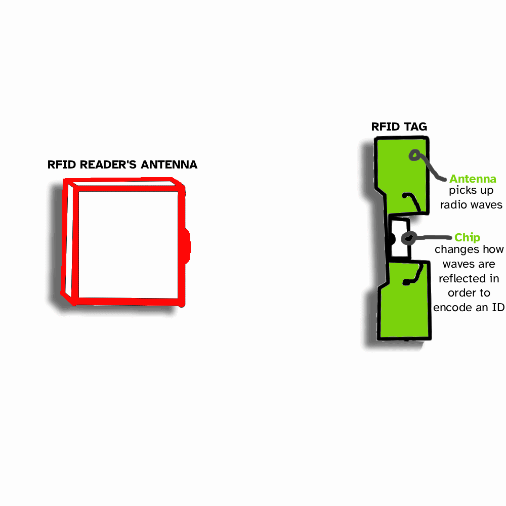

RFID (Radio-Frequency Identification) uses radio waves to communicate with tags attached to objects. Passive UHF RFID tags don't need their own batteries: they harvest energy from the reader's radio signal and use that energy to respond.

An Aside: RFID in History

> 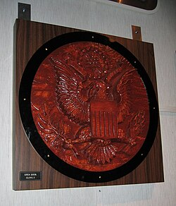

> During the final months of World War II, the United States ambassador to the Soviet Union received a carved wooden Great Seal as a gift. The carving was displayed in the ambassador's residence in Moscow, where it concealed a sophisticated listening device that went undetected for years.
> Known as The Thing, the device was passive: it had no battery of its own. Instead, an antenna inside the Thing would pick up ona radio signal from a van outside, reflecting parts of it back. A special microphone was used to change the antenna's properties, varying the signal reflected back towards the source.
> By detecting variations in this reflection, the USSR could recover the audio.
> The device was discovered in 1952, after being used to eavesdrop on the American diplomatic mission for approximately 7 years. The Thing wasn't a conventional digital RFID tag, but its use of radio backscatter makes it an interesting historical parallel to modern passive RFID technology.

A UHF RFID reader sends out a 860-960MHz radio signal, called the carrier wave. Some of this signal is absorbed by the tag's antenna and converted into power for a tiny computer on board. By changing the antenna's properties to selectively absorb more or less of the carrier wave, the reflected wave can be changed. This change in the reflection back is detected by the reader. This means the tag's computer can "send" data back without using any additional power.

The on-tag computer implements EPC Gen2, a communication and data storage protocol centered around reducing radio signal collisions. Further Reading: Anti Collision Algorithms

RFID's has become ubiquitous, with a wide range of uses ranging from supply chain and warehouse inventory management, to microchipping pets and stopping retail theft.

Because of this, our friends in Shenzhen, China have discovered ways of making this technology surprisingly accessible. Sample boards and high range antenna kits are widely available on Chinese Marketplaces like AliExpress.

---

## Electronics

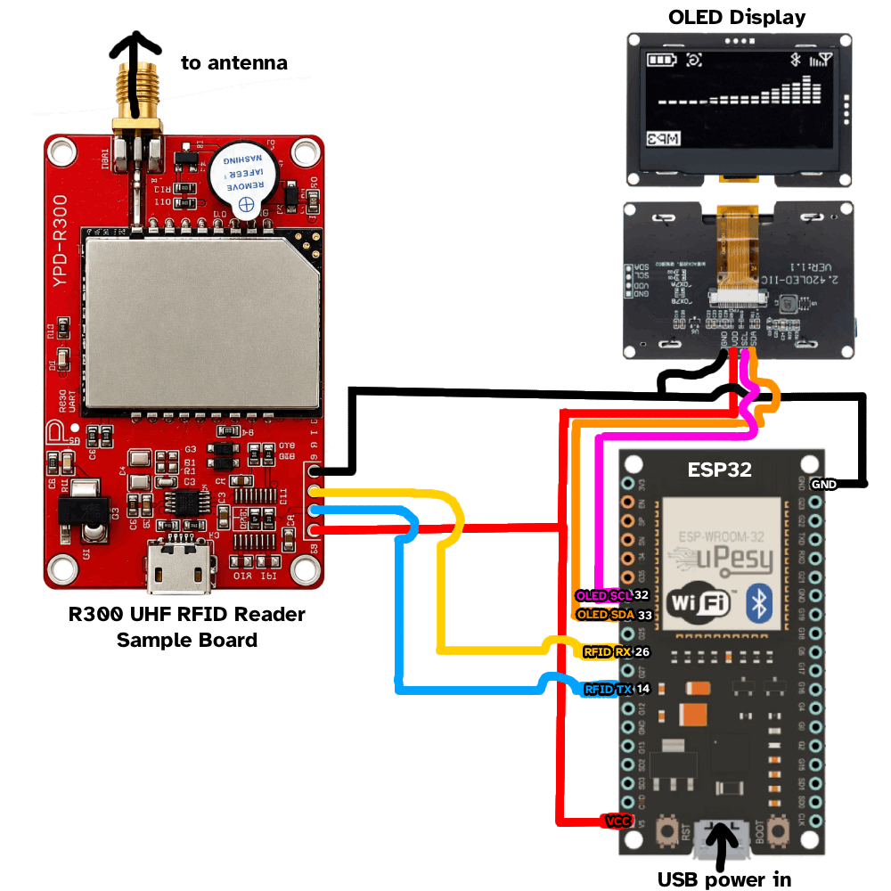

| ESP32 Pin | Destination                 |
| --------- | --------------------------- |
| +5V       | VCC on RFID and VCC on OLED |
| GND       | GND on RFID and GND on OLED |
| GPIO 14   | RFID TX                     |
| GPIO 26   | RFID RX                     |
| GPIO 33   | OLED SDA                    |
| GPIO 32   | OLED SCL                    |

### Parts List

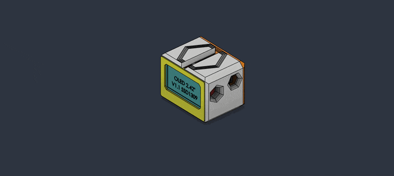

1. RodinBell M300 Series UHF RFID Reader

The easiest and cheapest way to source this chip is through a development board. You can find these on [AliExpress](https://www.aliexpress.us/w/wholesale-r200-uhf-rfid-reader-module.html) sold as R200 or R300 boards. [Here is what I purchased](https://www.aliexpress.us/item/3256810183614966.html).

2. Circularly polarized antenna

Many sample boards have the option of being sold with an antenna. I chose a 6 dBi circularly polarized antenna that came in a bundle with my reader board.

3. OLED Display

I chose a 2.42" SSD1309 128x64 OLED Display for size and cost. The size of this display board is around the same footprint as the RFID board and ESP32.

4. ESP32

Other microcontrollers should work though. ESP32 is probably overkill for this.

---

I was able to source the RFID reader board and antenna together from AliExpress for just under $100. I got the display from Amazon for $15 and the ESP32 for $5. Coming in at $120 total, this device is surprisingly economical for its functionality.

## Hardware

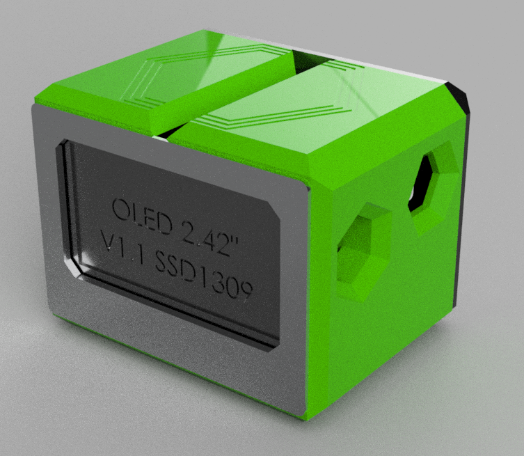 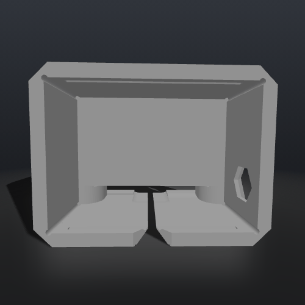

The electronics are held in a 3D printed case. STL files are available. If you'd like the (disorganized) Fusion 360 designs, send me an email.

## Software

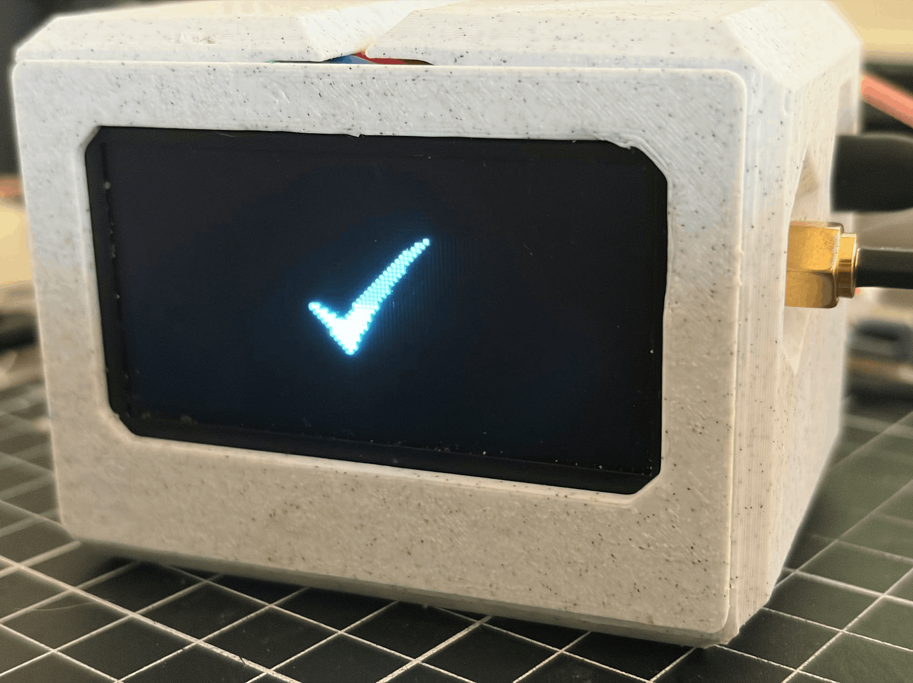



The ESP32 software only needs to periodically send inventory commands to the reader and listen for tag data back in response. The RFID board handles all of the actual RFID inventorying, collision avoidance, and nitty-gritty communication details. All the ESP32 has to do is issue "start inventory" commands and wait for tags to be detected. By default, the device will scan for all saved tags in the vicinity. Once all tags are read, the device shows a check mark and puts the processor to sleep. If, instead after 5 minutes, not all saved tags have been found, an X mark is instead displayed alongside a list of missing tools.

## Results and Testing

The antenna is positioned in the magazine holder behind the front passenger seat. Despite this less-than-ideal placement, performance has been stellar, exceeding my expectations for both detection range and reliability. This may be due to the radio waves bouncing around in the car.

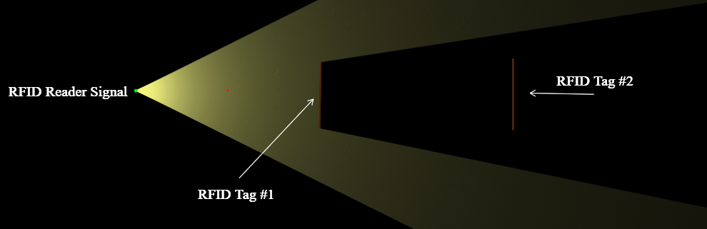

_Tag #2 is occluded by Tag #1_

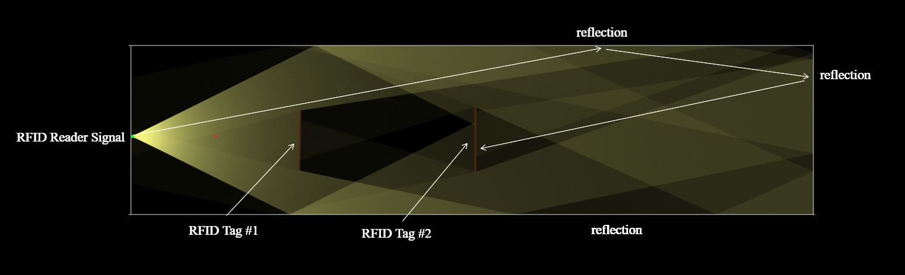

_Despite the lack of direct line of sight, reflections within the enclosed space may allow Tag #2 to receive enough RF energy to respond to the reader._

## Notes

- The RFID reader gets HOT when run continuously! To help mitigate this I placed a small heatsink on the RFID board's processor and oversized the cable outlet holes for airflow. This isn't a big problem in practice as the inventory cycle only lasts 5 minutes before timing out.

- The casing has a split in it to allow adding/removing the assembled wires and electronics easily.

- I placed the ESP32 on a protoboard with socket headers. This fills out the provided space nicely and makes the ESP32 swappable. You'll need to modify the 3D printed case if you don't have a 60mm X 80mm protoboard lying around to place the microcontroller on.
